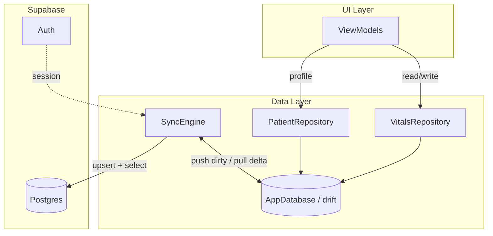
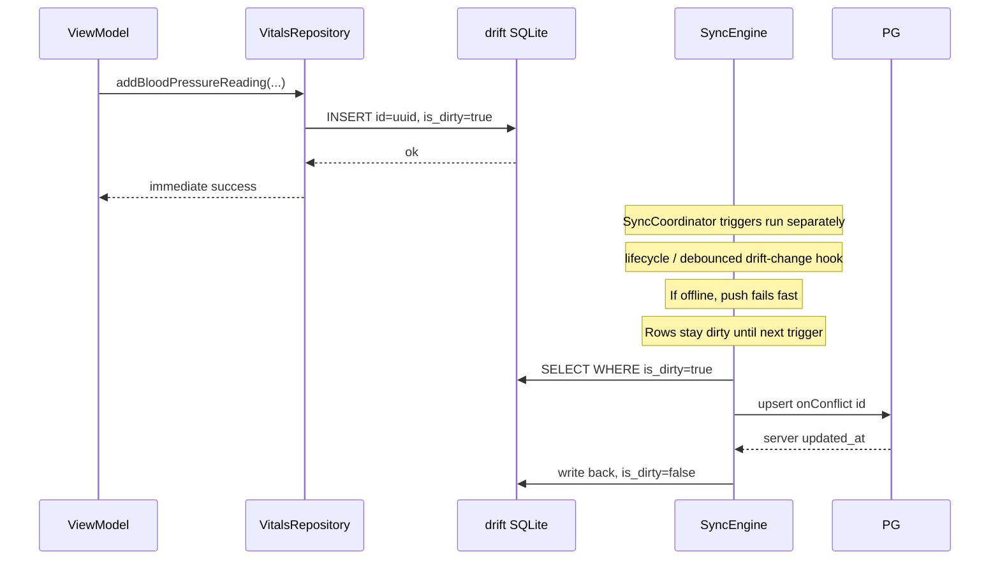
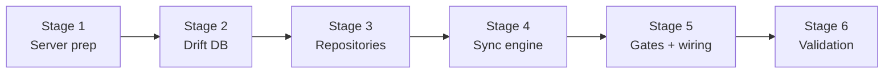

# Offline-First Architecture Plan

## Current state

Your app already has the right foundation and a detailed design in [planning/sync/v0/stage-1.md](planning/sync/v0/stage-1.md):

- **Auth**: Supabase wired in [app/lib/data/services/auth_service.dart](app/lib/data/services/auth_service.dart)
- **Vitals**: In-memory [app/lib/data/repositories/mock_vitals_repository.dart](app/lib/data/repositories/mock_vitals_repository.dart) — no persistence
- **Remote schema**: Applied in [supabase/migrations/20260703212925_stage_1_1_patient_vitals.sql](supabase/migrations/20260703212925_stage_1_1_patient_vitals.sql) (`patients` + 3 vitals, RLS, `updated_at` triggers on UPDATE)
- **State management**: Provider + ChangeNotifier ViewModels in [app/lib/app.dart](app/lib/app.dart)

---

## Core architectural invariant

**Drift is the single source of truth for the entire app.** Everything works offline.

| Layer | Reads from | Writes to | Talks to Supabase? |
|-------|-----------|-----------|-------------------|
| ViewModels / UI | Repositories | Repositories | Never |
| Repositories | drift only | drift only | Never |
| SyncEngine | drift | drift | Yes (push/pull only) |

The SyncEngine is an orthogonal layer that sits **on top of** drift — it never replaces the repository as the app's data interface. It observes drift for dirty rows and remote deltas, then writes reconciliation results back into drift.

**Hard rules:**
- Repositories have zero imports of `supabase_flutter` or `SyncEngine`
- All CRUD (create, read, update, delete) completes against drift synchronously from the UI's perspective — no network required
- Sync is best-effort background reconciliation, not part of the write path's success criteria

---

## Grill decisions (finalized)

| # | Question | Decision |
|---|----------|----------|
| 1 | Valid auth + empty drift DB + offline | **Block app** until first online pull |
| 2 | Offline CRUD scope for vitals | **Full CRUD** in repositories (create, update, soft-delete) |
| 3 | Edit/delete UI in stage-1 | **Repo only** — UI deferred |
| 4 | Patient profile offline | **Read offline** from drift; **writes require network** |
| 5 | LWW conflict visibility | **Silent** — no user notification in stage-1 |
| 6 | Sign-out local data | **Wipe entire drift DB** on sign-out |
| 7 | Expired JWT while offline | **Allow vitals to drift**; prompt re-login when online; sync after re-login |

---

## Architecture




### Data flow: offline CRUD




### Sync triggers (your choice: lifecycle-only)


| Trigger     | When                                                | Purpose                   |
| ----------- | --------------------------------------------------- | ------------------------- |
| App startup | After auth session confirmed                        | Catch up after cold start |
| App resumed | `WidgetsBindingObserver.didChangeAppLifecycleState` | Catch up after background |
| Post-write  | Debounced ~2s after any local write                 | Push new vitals promptly  |


No `connectivity_plus` listener. Sync attempts fail fast offline; the next lifecycle or write trigger retries automatically.

---

## Layer responsibilities

### 1. Local database (drift) — source of truth

Mirror remote tables 1:1 plus local-only columns, per [planning/sync/v0/stage-1.dbml](planning/sync/v0/stage-1.dbml) with one fix:


| Fix needed   | Remote (applied)          | Local DBML (stale)                                  |
| ------------ | ------------------------- | --------------------------------------------------- |
| Patient name | `first_name`, `last_name` | `full_name` — **update local schema**               |
| BP `source`  | Not in remote             | Remove from local BP table (or add to remote later) |


**Local-only additions on every synced table:**

- `isDirty` boolean — tracks unsynced changes
- `sync_state` table — `tableKey`, `lastPulledAt`, `lastSyncedRunAt` cursors

**New files:**

- `app/lib/data/local/app_database.dart` — drift database class
- `app/lib/data/local/tables/` — table definitions (patients, 3 vitals, sync_state)
- `app/lib/data/local/daos/` — query helpers (dirty rows, active rows `deletedAt IS NULL`)

**Dependencies to add** in [app/pubspec.yaml](app/pubspec.yaml):

```yaml
drift: ^2.x
drift_flutter: ^0.2.x   # or sqlite3_flutter_libs
path_provider: ^2.x
path: ^1.x
uuid: ^4.x              # client-generated IDs
```

Run `build_runner` for drift code generation.

### 2. Domain models — align with schema

Update models in [app/lib/domain/models/](app/lib/domain/models/) to include:

- `patientId` (UUID string) on all vitals
- `createdAt`, `updatedAt`, `deletedAt` (optional)
- `isDirty` stays **out of domain models** — it's a persistence concern, not business logic
- Generate UUIDs client-side on create: `Uuid().v4()`

Add `Patient` model with `firstName`, `lastName`, profile fields matching remote.

### 3. Repositories — drift-only (no sync coupling)

Replace `MockVitalsRepository` with `VitalsRepository` backed by drift DAOs. Repositories depend on `AppDatabase` only — not `SyncEngine`, not `SupabaseClient`.

```dart
// Pattern: every write sets isDirty=true + updatedAt=now(), returns immediately
Future<void> addBloodPressureReading(BloodPressureReading r) async {
  await _bpDao.insert(BloodPressureRow.fromDomain(
    r,
    isDirty: true,
    updatedAt: DateTime.now().toUtc(),
  ));
  // No sync call here — SyncCoordinator handles that externally
}
```

All read queries filter `deletedAt IS NULL`, ordered by `recordedAt DESC`.

Add `PatientRepository` for profile reads/writes (onboarding fills `first_name`/`last_name` locally, marks dirty).

**Patient profile rule (Grill decision):** Read offline from drift; profile **writes require network**. Vitals writes always go to drift immediately with no connectivity gate. When online, profile edits still follow drift-first pattern (`isDirty=true` → sync push).

**Offline CRUD scope (Grill decision: full CRUD):** Repositories support create, update, and soft-delete for all vitals tables:

| Operation | Local behavior | Sync behavior |
|-----------|---------------|---------------|
| Create | INSERT with client UUID, `isDirty=true` | Push upsert |
| Update | UPDATE fields + `updatedAt=now()`, `isDirty=true` | Push upsert |
| Delete | SET `deletedAt=now()`, `isDirty=true` (never hard-delete) | Push upsert; filtered from reads via `deletedAt IS NULL` |
| Read | SELECT WHERE `deletedAt IS NULL` | N/A (local only) |

LWW applies to updates and deletes the same way as creates — latest `updated_at` wins on conflict.

**UI scope (Grill decision):** Stage-1 implements full CRUD in repositories only. Edit/delete vitals UI screens are deferred to a later stage — existing add-only ViewModels continue to work.

### 3b. SyncCoordinator — triggers sync without repo coupling

Thin coordinator that wires sync triggers to `SyncEngine` without repositories knowing:

```dart
class SyncCoordinator {
  final SyncEngine _engine;
  Timer? _debounce;

  void onDriftWrite() {
    _debounce?.cancel();
    _debounce = Timer(const Duration(seconds: 2), () => _engine.run());
  }

  void onAppResumed() => _engine.run();
  void onAppStartup() => _engine.run();
}
```

DAO methods (or a drift transaction wrapper) notify `SyncCoordinator.onDriftWrite()` after successful writes. Alternatively, repositories accept an optional `VoidCallback onWrite` injected at DI time — still keeps repo free of sync logic.

### 4. SyncEngine — generic registry

Implement per [planning/sync/v0/stage-1.md](planning/sync/v0/stage-1.md) §5:

```dart
abstract class SyncableTable<T> {
  String get tableName;
  Future<List<T>> getDirtyRows();
  Map<String, dynamic> toRemoteJson(T row);
  Future<void> applyPushResult(List<Map<String, dynamic>> serverRows);
  Future<void> applyPulledRow(Map<String, dynamic> remoteRow);
}

class SyncEngine {
  final List<SyncableTable> registry; // patients, bp, glucose, weight
  Future<void> run() async {
    for (final t in registry) await _push(t);
    for (final t in registry) await _pull(t);
  }
}
```

**Push** (per table): `supabase.from(name).upsert(rows, onConflict: 'id').select()` → write server `updated_at` back, clear `isDirty`.

**Pull** (per table): `.select().eq('patient_id', patientId).gt('updated_at', lastPulledAt)` → apply with LWW conflict rule → advance cursor.

**Conflict resolution — last-write-wins (LWW)**

Applies only when the same row `id` exists both locally and remotely with divergent content. Distinct rows (different `id`) sharing the same `recorded_at` are **not** conflicts — both are kept.

| Comparison | Winner | Action |
|------------|--------|--------|
| `remote.updated_at > local.updated_at` | Remote | Overwrite local row, set `isDirty = false` |
| `local.updated_at >= remote.updated_at` | Local | Keep local row unchanged; if dirty, push overwrites server on next run |
| Equal `updated_at`, different content | Local (tie → local wins) | Keep dirty local row; push resolves |

**Timestamp authority:**
- **Local writes**: device UTC clock sets `updated_at` immediately (offline-safe)
- **After successful push**: replace local `updated_at` with server-assigned value (Postgres trigger overwrites client-sent value)
- **On pull**: compare server `updated_at` against local `updated_at` for LWW decision

Server `set_updated_at` trigger on INSERT OR UPDATE ensures pushed rows get authoritative timestamps, reducing clock-skew risk for cross-device conflicts.

**Conflict visibility (Grill decision):** Silent LWW in stage-1 — no user notification when a remote write overwrites a local change. Sync status UI deferred.

**Delete**: soft-delete only (`deletedAt = now()`, `isDirty = true`). Never hard-delete from SQLite.

**New files:**

- `app/lib/data/sync/sync_engine.dart`
- `app/lib/data/sync/syncable_table.dart`
- `app/lib/data/sync/tables/` — `PatientsSync`, `BpSync`, `GlucoseSync`, `WeightSync`

### 5. Bootstrap and first-login sync

**Server** (new migration): add `bootstrap_patient_on_signup()` trigger on `auth.users` INSERT — creates bare `patients` row. Already planned in [planning/db/v0/s1/s1.2/](planning/db/v0/s1/s1.2/).

Also extend `set_updated_at` trigger to fire on **INSERT OR UPDATE** (currently UPDATE-only in applied migration).

**Client first-login flow:**

1. User signs in → check if local drift has data for this auth user
2. **If local DB is empty AND device is offline → block the app** with a "Connect to the internet to sync your health data" screen. Do not allow vitals CRUD until first pull completes. (Grill decision: block, not optimistic bootstrap.)
3. If local DB is empty AND online → **blocking** full pull (all tables, `lastPulledAt = null`) with loading screen
4. If local DB has data → proceed normally (fully offline-capable)
5. Route to Home / Onboarding (if `firstName`/`lastName` null)

Wire in [app/lib/ui/features/auth/views/auth_gate.dart](app/lib/ui/features/auth/views/auth_gate.dart) or a new `InitialSyncGate` widget.

### 6. Lifecycle wiring

New `SyncLifecycleObserver` (implements `WidgetsBindingObserver`):

- On `resumed` → `syncEngine.run()`
- Registered in `main.dart` after DB init

Startup sync runs once after auth + DB ready.

**Sign-out behavior (Grill decision):** Wipe the entire drift DB on sign-out. Ensures no health data remains on device after logout. Next sign-in triggers fresh initial pull (requires network if local DB empty).

**Expired auth session (Grill decision):** Allow vitals CRUD to drift while device is offline, even if the Supabase JWT has expired. When the device comes back online with an expired session, `AuthGate` prompts re-login before sync runs. After successful re-login, trigger immediate sync to push any dirty rows logged while offline.

---

## Server-side delta (one migration)

Apply via `supabase/migrations/{timestamp}_bootstrap_and_updated_at.sql`:

1. `bootstrap_patient_on_signup()` trigger (security definer)
2. Change existing triggers from `BEFORE UPDATE` to `BEFORE INSERT OR UPDATE` on all 4 tables
3. RLS already applied — no changes needed

---

## DI changes in app.dart

```dart
// New provider tree (simplified)
Provider(create: (_) => AppDatabase()),
Provider(create: (ctx) => SyncEngine(
  db: ctx.read(),
  supabase: Supabase.instance.client,
  registry: [...],
)),
Provider(create: (ctx) => SyncCoordinator(
  engine: ctx.read(),
)),
Provider(create: (ctx) => VitalsRepository(
  db: ctx.read(),
  onWrite: () => ctx.read<SyncCoordinator>().onDriftWrite(),
)),
// Replace MockVitalsRepository everywhere
```

Pass `VitalsRepository` (abstract interface optional) to ViewModels instead of `MockVitalsRepository`.

---

## Implementation stages

Six stages, each independently testable. Complete and verify one stage before starting the next.



| Stage | Delivers | App state after |
|-------|----------|-----------------|
| 1 | Remote schema ready for sync | Unchanged (still mock repo) |
| 2 | Local SQLite with tables + DAOs | Unchanged (still mock repo) |
| 3 | Offline-only vitals app | Persists locally, no sync |
| 4 | Bidirectional sync | Offline CRUD + auto sync |
| 5 | Auth edge cases + gates | Production-ready offline-first |
| 6 | Verified against test plan | Ready to ship stage-1 |

---

### Stage 1 — Server prep

**Goal:** Remote Postgres is sync-ready before any client sync code is written.

**Tasks:**
- Create `supabase/migrations/{timestamp}_bootstrap_and_updated_at.sql`:
  - `bootstrap_patient_on_signup()` trigger on `auth.users` INSERT
  - Extend `set_updated_at` triggers to `BEFORE INSERT OR UPDATE` on all 4 tables
- Update [planning/sync/v0/stage-1.dbml](planning/sync/v0/stage-1.dbml): `full_name` → `first_name`/`last_name`, remove BP `source`
- Apply migration locally via Supabase CLI

**Files:**
- `supabase/migrations/*_bootstrap.sql` (create)
- `planning/sync/v0/stage-1.dbml` (update)

**Exit criteria:**
- [x] New user signup auto-creates a bare `patients` row
- [x] INSERT sets `updated_at` via trigger (not just UPDATE)
- [x] Local DBML matches applied remote schema

**App impact:** None — Flutter app unchanged.

---

### Stage 2 — Drift local database

**Goal:** Local SQLite schema exists with DAOs; no repositories or UI changes yet.

**Tasks:**
- Add deps to [app/pubspec.yaml](app/pubspec.yaml): `drift`, `drift_flutter`, `path_provider`, `path`, `uuid`, `build_runner`, `drift_dev`
- Create drift tables: `patients`, `blood_pressure_readings`, `blood_glucose_readings`, `weight_readings`, `sync_state`
- Each synced table gets `isDirty` column; reads filter `deletedAt IS NULL`
- Create DAOs: dirty-row queries, active-row queries, CRUD helpers per table
- Update domain models: `patientId`, UUID ids, `createdAt`/`updatedAt`/`deletedAt`; add `Patient` model
- Run `dart run build_runner build`
- Initialize `AppDatabase` in `main.dart` (open DB on startup, no wiring to repos yet)

**Files:**
- `app/lib/data/local/app_database.dart` (create)
- `app/lib/data/local/tables/*.dart` (create)
- `app/lib/data/local/daos/*.dart` (create)
- `app/lib/domain/models/*.dart` (update)
- `app/lib/main.dart` (DB init only)
- `app/pubspec.yaml` (deps)

**Exit criteria:**
- [x] App compiles with drift codegen
- [x] Can insert/query vitals rows via DAO in a unit test or debug harness
- [x] `schemaVersion = 1` with empty `onUpgrade` stub for future migrations

**App impact:** None visible — mock repo still serves UI.

---

### Stage 3 — Repositories (offline-only)

**Goal:** App reads/writes drift exclusively. Fully offline-capable with no sync yet.

**Tasks:**
- Create `VitalsRepository` — full CRUD (create, update, soft-delete, read) against drift DAOs
  - Every write sets `isDirty = true`, `updatedAt = DateTime.now().toUtc()`
  - No Supabase imports
- Create `PatientRepository` — read from drift; write method checks connectivity before allowing profile edits
- Wire `onWrite` callback (injected at DI, no sync logic in repo)
- Replace `MockVitalsRepository` in [app/lib/app.dart](app/lib/app.dart) DI
- Update ViewModel constructor types
- Delete `mock_vitals_repository.dart`
- Seed local `patients` row manually in dev (or via debug helper) until Stage 4 provides pull

**Files:**
- `app/lib/data/repositories/vitals_repository.dart` (create)
- `app/lib/data/repositories/patient_repository.dart` (create)
- `app/lib/app.dart` (DI swap)
- `app/lib/ui/features/**/view_models/*.dart` (type updates)
- `app/lib/data/repositories/mock_vitals_repository.dart` (delete)

**Exit criteria:**
- [x] Log vitals in airplane mode → data persists across app restart
- [x] Soft-delete removes reading from UI but row remains in SQLite with `deletedAt` set
- [x] Profile readable offline; profile write blocked offline with user-facing message
- [x] No imports of `supabase_flutter` in repository files

**App impact:** Users get persistent local vitals. Data stays on device only (no cloud sync yet).

---

### Stage 4 — Sync engine

**Goal:** Dirty local rows push to Supabase; remote changes pull down with silent LWW.

**Tasks:**
- Create `SyncableTable` abstract class + 4 implementations (`PatientsSync`, `BpSync`, `GlucoseSync`, `WeightSync`)
- Create `SyncEngine`:
  - Push: query dirty rows → batched `upsert(onConflict: 'id').select()` → write server `updated_at` back, clear `isDirty`
  - Pull: read `sync_state.lastPulledAt` → incremental select → apply LWW → advance cursor
  - Registry order: patients first, then vitals (FK dependency)
- Create `SyncCoordinator`:
  - Debounced `onDriftWrite()` (~2s)
  - `onAppStartup()` / `onAppResumed()` hooks
- Wire `SyncCoordinator.onDriftWrite` as repo `onWrite` callback in DI
- Wire `SyncLifecycleObserver` in `main.dart`

**Files:**
- `app/lib/data/sync/syncable_table.dart` (create)
- `app/lib/data/sync/sync_engine.dart` (create)
- `app/lib/data/sync/sync_coordinator.dart` (create)
- `app/lib/data/sync/tables/*.dart` (create)
- `app/lib/app.dart` (SyncEngine + SyncCoordinator providers)
- `app/lib/main.dart` (lifecycle observer)

**Exit criteria:**
- [x] Log vitals offline → go online → rows appear in Supabase dashboard
- [x] Edit on server → pull on app resume → local data updates
- [x] Same-id conflict: newer `updated_at` wins silently
- [x] Push failure leaves rows dirty; next lifecycle trigger retries

**App impact:** Full offline CRUD with background sync. No first-login gate yet (assumes local data exists from dev seed or prior session).

---

### Stage 5 — Gates and auth edge cases

**Goal:** Handle first-login, sign-out, expired sessions, and empty-DB-offline scenarios.

**Tasks:**
- Create `InitialSyncGate` widget:
  - Empty drift DB + offline → block with "Connect to the internet to sync your health data"
  - Empty drift DB + online → blocking full pull with loading screen
  - Has local data → pass through to app
- Wire gate in auth flow ([auth_gate.dart](app/lib/ui/features/auth/views/auth_gate.dart) or new wrapper)
- Sign-out: wipe entire drift DB before clearing auth session
- Re-login after expired JWT: trigger immediate `SyncEngine.run()` to push dirty rows
- Remove any dev-only patient seed helpers from Stage 3

**Files:**
- `app/lib/ui/features/sync/views/initial_sync_gate.dart` (create)
- `app/lib/ui/features/auth/views/auth_gate.dart` (update)
- `app/lib/data/repositories/auth_repository.dart` or sign-out flow (wipe DB)
- `app/lib/main.dart` (re-login sync hook)

**Exit criteria:**
- [x] Fresh install + offline → blocked with message (not crash/empty state)
- [x] Fresh install + online → full pull completes, then home screen
- [x] Sign-out → drift DB empty; re-login requires fresh pull
- [x] Expired token offline → vitals still loggable; online → re-login prompt → dirty rows sync

**App impact:** Production-ready offline-first flow for all grill scenarios.

---

### Stage 6 — Manual validation

**Goal:** Verify all grill decisions and edge cases before marking stage-1 complete.

**Test plan:**

| # | Scenario | Steps | Expected |
|---|----------|-------|----------|
| 1 | Offline create | Airplane mode → log BP → restart app | Reading visible, `isDirty=true` in DB |
| 2 | Reconnect sync | Toggle online → wait for sync trigger | Row in Supabase, `isDirty=false` locally |
| 3 | Offline update | Edit reading offline (via repo/debug) | Local change persists, syncs on reconnect |
| 4 | Offline delete | Soft-delete reading offline | Hidden from UI, `deletedAt` set, syncs on reconnect |
| 5 | LWW conflict | Edit same row on two devices offline → sync both | Newer `updated_at` wins, no crash |
| 6 | Empty DB offline | Clear drift → go offline → open app | Blocked with sync message |
| 7 | Fresh install online | Install → sign in online | Blocking pull → home with history |
| 8 | Sign-out wipe | Sign out → inspect drift DB | All tables empty |
| 9 | Expired JWT | Log vitals offline with expired token → go online | Re-login prompt → dirty rows push |
| 10 | Drift migration | Mark row dirty → bump schemaVersion → upgrade | Dirty row preserved, still syncs |

**Exit criteria:**
- [ ] All 10 scenarios pass
- [ ] No regressions in existing auth/onboarding flows

**App impact:** None — verification only.

---

## Explicitly deferred (per your existing plan)

- Edit/delete vitals UI screens
- Sync status UI (pending count, error banner, conflict notifications)
- Native background sync (WorkManager / BGTaskScheduler)
- `connectivity_plus` listener
- Pull pagination (revisit when history grows)
- Remaining 10 entities (labs, meds, appointments, etc.)

---

## File map (new/changed)


| Path                                                | Action                       |
| --------------------------------------------------- | ---------------------------- |
| `app/lib/data/local/app_database.dart`              | Create                       |
| `app/lib/data/local/tables/*.dart`                  | Create                       |
| `app/lib/data/local/daos/*.dart`                    | Create                       |
| `app/lib/data/sync/sync_coordinator.dart`          | Create                       |
| `app/lib/data/sync/sync_engine.dart`                | Create                       |
| `app/lib/data/sync/tables/*.dart`                   | Create                       |
| `app/lib/data/repositories/vitals_repository.dart`  | Create (replaces mock)       |
| `app/lib/data/repositories/patient_repository.dart` | Create                       |
| `app/lib/domain/models/*.dart`                      | Update                       |
| `app/lib/app.dart`                                  | Update DI                    |
| `app/lib/main.dart`                                 | DB init + lifecycle observer |
| `supabase/migrations/*_bootstrap.sql`               | Create                       |
| `planning/sync/v0/stage-1.dbml`                     | Fix schema drift             |


