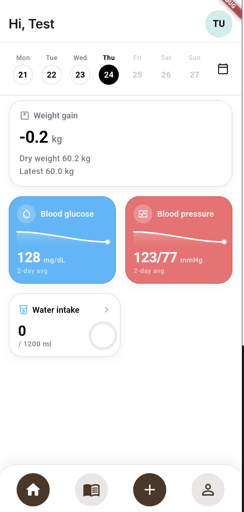
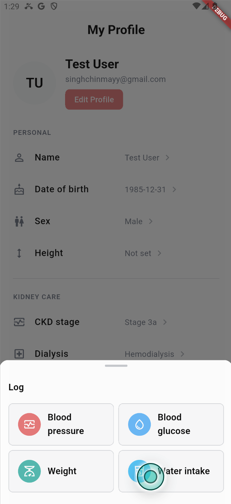
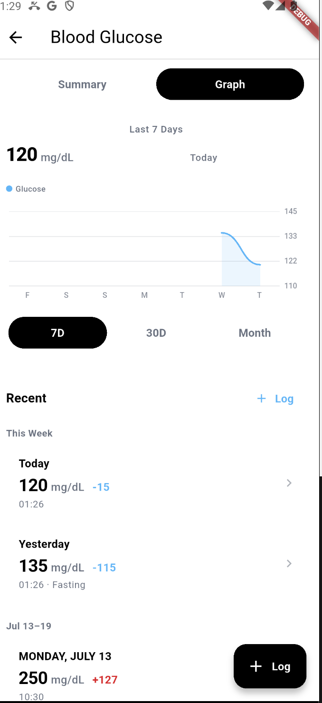

# Kidney Care

Kidney Care is a Flutter mobile app for recording patient health data—blood pressure, blood glucose, weight, fluid intake, dialysis context, profile preferences, and medication schedules. The project is a working engineering prototype focused on an offline-first client and a Supabase/Postgres backend.

The useful engineering problem is data durability: a patient should be able to record a reading locally without depending on a network request, then synchronize it when the app is active and connectivity is available. The repository also demonstrates local schema migrations, row-level access policies, validation, soft deletes, conflict resolution, and automated tests.

## Screenshots

These are debug/sample captures of the current Flutter UI. Values shown are synthetic development data.

<table>
  <tr>
    <td></td>
    <td></td>
    <td></td>
  </tr>
  <tr>
    <td align="center">Home dashboard</td>
    <td align="center">Log a vital</td>
    <td align="center">Stats and history</td>
  </tr>
</table>

## Current status

Implemented today:

- Email/password sign-in, sign-up, session-driven auth routing, sign-out, and local data wipe on sign-out through Supabase Auth.
- Patient onboarding/profile editing, CKD stage, dialysis type/days, height, unit preferences, and daily water goal.
- Local SQLite persistence through Drift for patient data, blood pressure, glucose, weight, fluid intake, medication catalog, medication schedules, and sync state.
- Add, edit, delete, recent-history, summaries, and charts for blood pressure, glucose, weight, and fluid intake. Deletes are soft deletes locally and remotely.
- Medication catalog seeded locally plus per-dialysis-day medication schedules.
- Bidirectional push/pull synchronization for `patients`, `patient_preferences`, `blood_pressure_readings`, `blood_glucose_readings`, `weight_readings`, `fluid_intake_logs`, and `patient_medication_schedules`.
- Supabase migrations with Postgres constraints, server-side `updated_at` triggers, signup bootstrap triggers, indexes, grants, and patient-scoped RLS policies.
- Unit, repository, sync, converter, and widget tests.

Partial or known-broken today:

- `flutter analyze` reports 52 informational lint issues and exits non-zero.
- `flutter test` runs 156 tests but currently has 5 failures. See [Testing and operations](docs/testing-and-operations.md).
- Sync is foreground-only. It runs at startup/resume, after local writes with a two-second debounce, and after connectivity restoration; it has no native background worker, sync-status UI, or dedicated exponential backoff loop.
- Login UI exposes Google sign-in, guest login, and password reset as placeholders. Caretaker linking is UI-only.

Planned or deferred:

- Caretaker/patient access model and invite/linking flow.
- Google/guest authentication and password reset.
- Native background synchronization, visible sync status, retry/backoff, and broader operational telemetry.
- Additional clinical domains from the planning documents, such as labs, symptoms, appointments, dialysis sessions, documents, and reminders.

This is not presented as a production medical system or as evidence of production traffic, compliance certification, measured scale, or clinical validation.

## Architecture and data flow

```text
Flutter UI
  -> ChangeNotifier view models
  -> repositories (auth, patient, vitals, medications)
  -> Drift DAOs / SQLite (local source of truth)
       -> dirty rows + soft-delete timestamps + per-table sync cursors
  -> debounced SyncCoordinator
  -> registry-driven SyncEngine
  -> Supabase Auth + PostgREST/Postgres
       -> RLS scopes rows through auth.uid() and patients.auth_user_id
```

Writes are local-first. A repository writes through a Drift DAO, marks the row dirty, and schedules a debounced sync. The engine pushes dirty rows, then pulls rows newer than each table's cursor. Same-ID conflicts use `updated_at` last-write-wins; the database trigger makes the server timestamp authoritative. The first signed-in device is held behind an initial sync gate until local patient data exists or the user is shown an offline/error state.

More detail is in [Architecture](docs/architecture.md) and [Database and sync](docs/database-and-sync.md).

## Tech stack and reasons

| Area | Choice | Reason visible in the code |
|---|---|---|
| Client | Flutter / Dart | One mobile UI codebase with widget and unit testing. |
| State/dependencies | `provider` + `ChangeNotifier` | Explicit repository/view-model wiring in `app/lib/app.dart`; simple test seams. |
| Local persistence | Drift over SQLite | Typed tables/DAOs, generated query code, in-memory test databases, and versioned migrations. |
| Remote backend | Supabase Auth + Postgres/PostgREST | Managed auth, relational constraints, SQL migrations, and RLS close to the data. |
| Sync | Custom registry-driven engine | Shared push/pull/conflict behavior across tables without coupling UI to transport. |
| Connectivity | `connectivity_plus` plus an HTTP probe | Gate initial sync and trigger foreground retries without claiming offline detection is proof of internet reachability. |

## Local setup

Prerequisites:

- Flutter 3.44.3 / Dart 3.12.2 (the versions used for the verification in this repository).
- A Supabase project, or the Supabase CLI/local stack if you want to apply the included migrations locally.

```bash
cd app
flutter pub get
cp dart_defines/dev.example.json dart_defines/dev.json
# Edit dev.json with your own project URL and publishable/anon key.
flutter run --dart-define-from-file=dart_defines/dev.json
```

The app reads only these build-time variables:

- `SUPABASE_URL`
- `SUPABASE_PUBLISHABLE_KEY`

Do not commit `dart_defines/dev.json`, service-role keys, database passwords, JWT signing keys, or real patient data. The example file contains placeholders only.

For a local Supabase stack, apply the migrations under `supabase/migrations/` using the Supabase CLI. The checked-in `supabase/config.toml` configures local API, database, Studio, Auth, Realtime, and a seed path; note that `supabase/seed.sql` is not currently present, so a reset that expects the configured seed file needs to be checked before relying on it. This repository does not include a deployment pipeline or a production project configuration.

## Tests and checks

From `app/`:

```bash
flutter analyze
flutter test
```

The current results are recorded in [Testing and operations](docs/testing-and-operations.md). Tests use `NativeDatabase.memory()` for Drift and fake/in-memory Supabase auth storage where needed; they do not prove that a real remote Supabase project has been deployed or that device builds work on every platform.

## Deployment and operation

There is no CI workflow, Dockerfile, release script, or documented production deployment in the repository. Operationally, a developer must configure Supabase, apply migrations in order, provide the two Dart defines at build/run time, and run a Flutter platform build such as `flutter build apk` or `flutter build ios` after platform signing setup.

The app is foreground-operated: local changes remain in SQLite while offline, and later sync attempts occur on app startup/resume, after writes, or when connectivity returns. Because sync failures are logged and rows remain dirty, an operator should treat a successful app launch as distinct from confirmed remote synchronization.

## Limitations and next steps

The highest-value next steps are:

1. Fix the five failing tests and add regression coverage for the period/list grouping rules.
2. Make analysis clean, starting with the current 52 informational issues and the test-only dependency warning.
3. Add observable sync state and durable retry/backoff, then exercise offline/reconnect flows against a local Supabase stack.
4. Design caregiver authorization before implementing caretaker linking; current RLS is patient-owner-only.
5. Add CI that runs `flutter analyze`, `flutter test`, and migration validation on every change.

UI decisions and history remain in [docs/Design/design.md](docs/Design/design.md); it is a design reference, not a claim that every older mock-screen note is still current.
