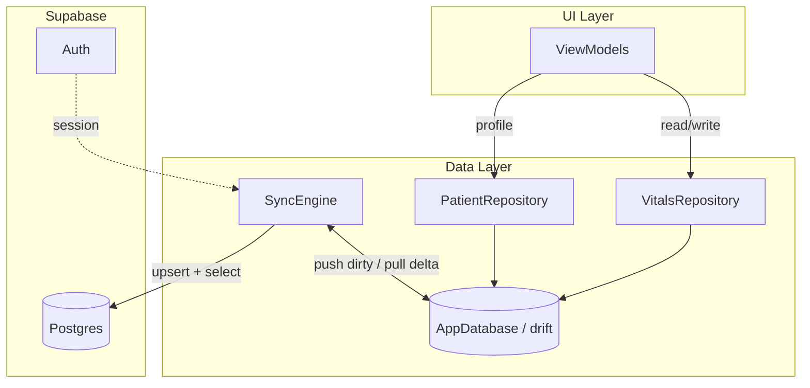
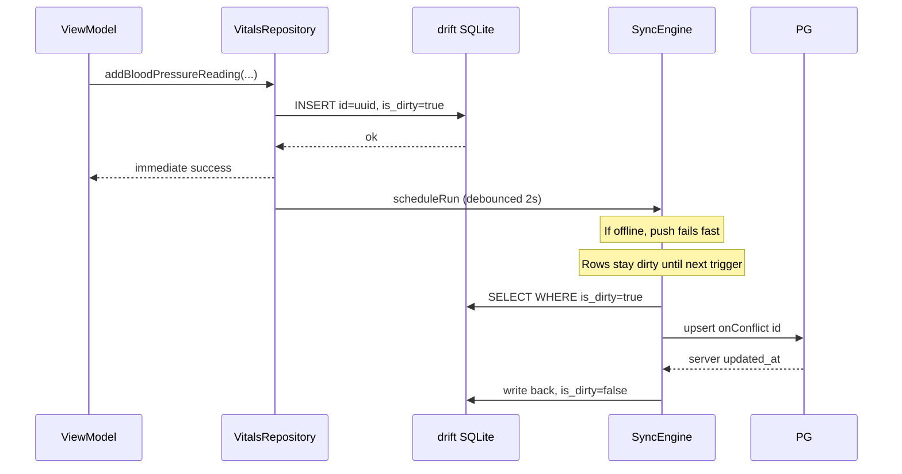

# Offline-First Architecture Plan

## Current state

Your app already has the right foundation and a detailed design in [planning/sync/v0/stage-1.md](planning/sync/v0/stage-1.md):

- **Auth**: Supabase wired in [app/lib/data/services/auth_service.dart](app/lib/data/services/auth_service.dart)
- **Vitals**: In-memory [app/lib/data/repositories/mock_vitals_repository.dart](app/lib/data/repositories/mock_vitals_repository.dart) — no persistence
- **Remote schema**: Applied in [supabase/migrations/20260703212925_stage_1_1_patient_vitals.sql](supabase/migrations/20260703212925_stage_1_1_patient_vitals.sql) (`patients` + 3 vitals, RLS, `updated_at` triggers on UPDATE)
- **State management**: Provider + ChangeNotifier ViewModels in [app/lib/app.dart](app/lib/app.dart)

**3**

---

## Architecture




### Data flow: offline CRUD




### Sync triggers (your choice: lifecycle-only)


| Trigger     | When                                                | Purpose                   |
| ----------- | --------------------------------------------------- | ------------------------- |
| App startup | After auth session confirmed                        | Catch up after cold start |
| App resumed | `WidgetsBindingObserver.didChangeAppLifecycleState` | Catch up after background |
| Post-write  | Debounced ~2s after any local write                 | Push new vitals promptly  |


No `connectivity_plus` listener. Sync attempts fail fast offline; the next lifecycle or write trigger retries automatically.

---

## Layer responsibilities

### 1. Local database (drift) — source of truth

Mirror remote tables 1:1 plus local-only columns, per [planning/sync/v0/stage-1.dbml](planning/sync/v0/stage-1.dbml) with one fix:


| Fix needed   | Remote (applied)          | Local DBML (stale)                                  |
| ------------ | ------------------------- | --------------------------------------------------- |
| Patient name | `first_name`, `last_name` | `full_name` — **update local schema**               |
| BP `source`  | Not in remote             | Remove from local BP table (or add to remote later) |


**Local-only additions on every synced table:**

- `isDirty` boolean — tracks unsynced changes
- `sync_state` table — `tableKey`, `lastPulledAt`, `lastSyncedRunAt` cursors

**New files:**

- `app/lib/data/local/app_database.dart` — drift database class
- `app/lib/data/local/tables/` — table definitions (patients, 3 vitals, sync_state)
- `app/lib/data/local/daos/` — query helpers (dirty rows, active rows `deletedAt IS NULL`)

**Dependencies to add** in [app/pubspec.yaml](app/pubspec.yaml):

```yaml
drift: ^2.x
drift_flutter: ^0.2.x   # or sqlite3_flutter_libs
path_provider: ^2.x
path: ^1.x
uuid: ^4.x              # client-generated IDs
```

Run `build_runner` for drift code generation.

### 2. Domain models — align with schema

Update models in [app/lib/domain/models/](app/lib/domain/models/) to include:

- `patientId` (UUID string) on all vitals
- `createdAt`, `updatedAt`, `deletedAt` (optional)
- `isDirty` stays **out of domain models** — it's a persistence concern, not business logic
- Generate UUIDs client-side on create: `Uuid().v4()`

Add `Patient` model with `firstName`, `lastName`, profile fields matching remote.

### 3. Repositories — local-only reads/writes

Replace `MockVitalsRepository` with `VitalsRepository` backed by drift DAOs:

```dart
// Pattern: every write sets isDirty=true, never calls Supabase
Future<void> addBloodPressureReading(BloodPressureReading r) async {
  await _bpDao.insert(BloodPressureRow.fromDomain(r, isDirty: true));
  _syncEngine.scheduleRun(); // debounced
}
```

All read queries filter `deletedAt IS NULL`, ordered by `recordedAt DESC`.

Add `PatientRepository` for profile reads/writes (onboarding fills `first_name`/`last_name` locally, marks dirty).

**Interface stays the same** — ViewModels in [app/lib/ui/features/vitals/view_models/](app/lib/ui/features/vitals/view_models/) need minimal changes (swap repository type in DI).

### 4. SyncEngine — generic registry

Implement per [planning/sync/v0/stage-1.md](planning/sync/v0/stage-1.md) §5:

```dart
abstract class SyncableTable<T> {
  String get tableName;
  Future<List<T>> getDirtyRows();
  Map<String, dynamic> toRemoteJson(T row);
  Future<void> applyPushResult(List<Map<String, dynamic>> serverRows);
  Future<void> applyPulledRow(Map<String, dynamic> remoteRow);
}

class SyncEngine {
  final List<SyncableTable> registry; // patients, bp, glucose, weight
  Future<void> run() async {
    for (final t in registry) await _push(t);
    for (final t in registry) await _pull(t);
  }
}
```

**Push** (per table): `supabase.from(name).upsert(rows, onConflict: 'id').select()` → write server `updated_at` back, clear `isDirty`.

**Pull** (per table): `.select().eq('patient_id', patientId).gt('updated_at', lastPulledAt)` → apply with LWW conflict rule → advance cursor.

**Conflict resolution** (same `id` only):

- Remote `updated_at` newer → overwrite local, clear dirty
- Local equal/newer → keep dirty, wins on next push
- Server assigns `updated_at` via Postgres trigger (eliminates clock skew)

**Delete**: soft-delete only (`deletedAt = now()`, `isDirty = true`). Never hard-delete from SQLite.

**New files:**

- `app/lib/data/sync/sync_engine.dart`
- `app/lib/data/sync/syncable_table.dart`
- `app/lib/data/sync/tables/` — `PatientsSync`, `BpSync`, `GlucoseSync`, `WeightSync`

### 5. Bootstrap and first-login sync

**Server** (new migration): add `bootstrap_patient_on_signup()` trigger on `auth.users` INSERT — creates bare `patients` row. Already planned in [planning/db/v0/s1/s1.2/](planning/db/v0/s1/s1.2/).

Also extend `set_updated_at` trigger to fire on **INSERT OR UPDATE** (currently UPDATE-only in applied migration).

**Client first-login flow:**

1. User signs in → resolve `patientId` from local `patients` row (or pull patient row first)
2. If no local data: **blocking** full pull (all tables, `lastPulledAt = null`)
3. Show loading screen during initial sync
4. Then route to Home / Onboarding (if `firstName`/`lastName` null)

Wire in [app/lib/ui/features/auth/views/auth_gate.dart](app/lib/ui/features/auth/views/auth_gate.dart) or a new `InitialSyncGate` widget.

### 6. Lifecycle wiring

New `SyncLifecycleObserver` (implements `WidgetsBindingObserver`):

- On `resumed` → `syncEngine.run()`
- Registered in `main.dart` after DB init

Startup sync runs once after auth + DB ready.

---

## Server-side delta (one migration)

Apply via `supabase/migrations/{timestamp}_bootstrap_and_updated_at.sql`:

1. `bootstrap_patient_on_signup()` trigger (security definer)
2. Change existing triggers from `BEFORE UPDATE` to `BEFORE INSERT OR UPDATE` on all 4 tables
3. RLS already applied — no changes needed

---

## DI changes in app.dart

```dart
// New provider tree (simplified)
Provider(create: (_) => AppDatabase()),
Provider(create: (ctx) => SyncEngine(
  db: ctx.read(),
  supabase: Supabase.instance.client,
  registry: [...],
)),
Provider(create: (ctx) => VitalsRepository(
  db: ctx.read(),
  syncEngine: ctx.read(),
)),
// Replace MockVitalsRepository everywhere
```

Pass `VitalsRepository` (abstract interface optional) to ViewModels instead of `MockVitalsRepository`.

---

## Implementation phases

### Phase 1 — Server prep

- New Supabase migration: bootstrap trigger + INSERT `updated_at` triggers
- Update [planning/sync/v0/stage-1.dbml](planning/sync/v0/stage-1.dbml): `full_name` → `first_name`/`last_name`, remove BP `source`

### Phase 2 — Local DB

- Add drift deps + `AppDatabase` with 5 tables
- DAOs with dirty/active-row queries
- Schema version 1 + migration strategy (`onUpgrade`)

### Phase 3 — Repositories

- `VitalsRepository` + `PatientRepository` (local-only CRUD)
- Update domain models (UUID, patientId, timestamps)
- Swap DI; delete mock repo

### Phase 4 — Sync engine

- `SyncableTable` registry for 4 tables
- `SyncEngine.run()` push-then-pull
- LWW conflict logic in `applyPulledRow`
- Debounced `scheduleRun()`

### Phase 5 — Wiring + first-login

- `SyncLifecycleObserver` in `main.dart`
- `InitialSyncGate` blocking screen
- Patient bootstrap resolution after sign-in

### Phase 6 — Manual validation

- Log vitals in airplane mode → reconnect → verify in Supabase dashboard
- Two-device same-id conflict test
- App update with dirty rows still pending → verify drift migration preserves them

---

## Explicitly deferred (per your existing plan)

- Sync status UI (pending count, error banner)
- Native background sync (WorkManager / BGTaskScheduler)
- `connectivity_plus` listener
- Pull pagination (revisit when history grows)
- Remaining 10 entities (labs, meds, appointments, etc.)

---

## File map (new/changed)


| Path                                                | Action                       |
| --------------------------------------------------- | ---------------------------- |
| `app/lib/data/local/app_database.dart`              | Create                       |
| `app/lib/data/local/tables/*.dart`                  | Create                       |
| `app/lib/data/local/daos/*.dart`                    | Create                       |
| `app/lib/data/sync/sync_engine.dart`                | Create                       |
| `app/lib/data/sync/tables/*.dart`                   | Create                       |
| `app/lib/data/repositories/vitals_repository.dart`  | Create (replaces mock)       |
| `app/lib/data/repositories/patient_repository.dart` | Create                       |
| `app/lib/domain/models/*.dart`                      | Update                       |
| `app/lib/app.dart`                                  | Update DI                    |
| `app/lib/main.dart`                                 | DB init + lifecycle observer |
| `supabase/migrations/*_bootstrap.sql`               | Create                       |
| `planning/sync/v0/stage-1.dbml`                     | Fix schema drift             |


