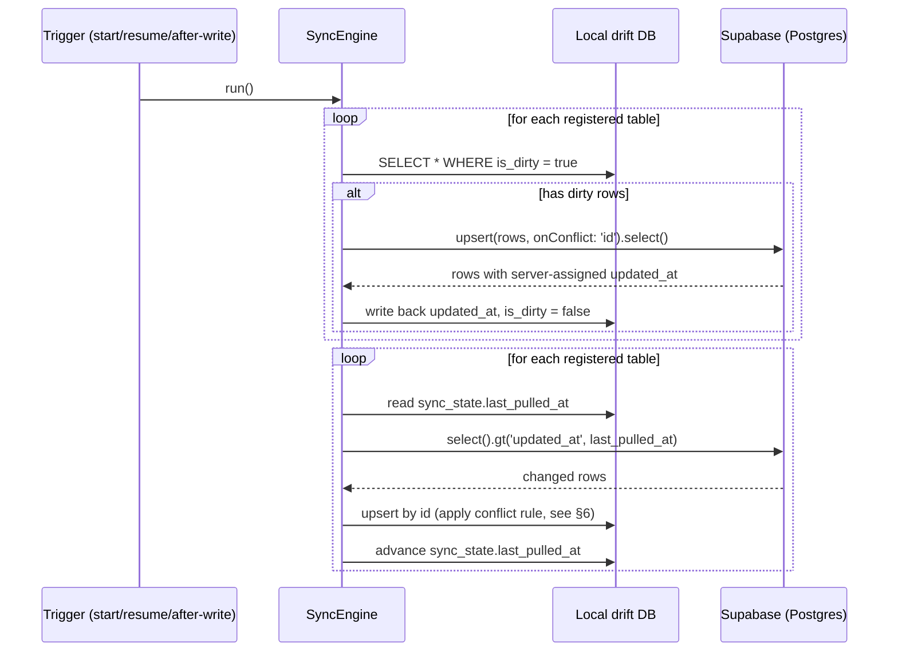

# Kidney Care — Local DB & Sync Implementation Plan (v0 / stage-1)

Date: 2026-07-03

## 1. Summary

Implementation plan for the offline-first local database and bidirectional sync engine that lets a patient log vitals with no network connection and have that data reliably reach Supabase/Postgres once online. Built on top of the schema in `planning/db/v0/s1/s1.2/s1.2.dbml` (`patients` + `blood_pressure_readings` + `blood_glucose_readings` + `weight_readings`). The local store is `drift` (SQLite) mirroring the remote schema 1:1, plus two local-only additions: an `is_dirty` flag per row and a `sync_state` cursor table. The sync engine is deliberately generic/registry-driven so the other 10 entities deferred from s1 can be added later by registering them, not by rewriting the engine.

## 2. Scope

- **In scope**: local DB setup, push/pull sync engine, conflict resolution, delete handling, local schema migrations, patient bootstrap, required server-side triggers/RLS.
- **Out of scope for this stage** (deferred, see §10): sync status UI, native background execution (app-killed sync), connectivity-listener package, dedicated retry/backoff timer, tables beyond `patients` + 3 vitals.

## 3. Architecture Overview

```mermaid
flowchart LR
    subgraph Device["Flutter App (device)"]
        UI[UI: log vitals / view trends]
        Local[(drift / SQLite\nlocal DB)]
        Engine[SyncEngine]
        UI -->|write, read| Local
        Engine <--> Local
    end
    subgraph Cloud["Supabase"]
        Auth[Supabase Auth]
        PG[(Postgres)]
    end
    Engine -->|upsert / select\nvia supabase_flutter| PG
    Auth -.->|session / auth.uid()| Engine
    Auth -.->|trigger: bootstrap patients row| PG
```

One sync run (triggered per §5.2):



## 4. Local Schema (drift)

See `planning/sync/v0/stage-1.dbml` for full definitions. Summary of what's local-only vs. mirrored:

| Table | Mirrors remote? | Local-only additions |
|---|---|---|
| `patients` | Yes, 1:1 with `s1.2` | `is_dirty` |
| `blood_pressure_readings` | Yes, 1:1 with `s1.1` | `is_dirty` |
| `blood_glucose_readings` | Yes, 1:1 with `s1.1` | `is_dirty` |
| `weight_readings` | Yes, 1:1 with `s1.1` | `is_dirty` |
| `sync_state` | No — local only | entire table (`table_name` pk, `last_pulled_at`, `last_synced_run_at`) |

## 5. Sync Engine Design

### 5.1 Generic registry pattern

The engine is driven by a list of table configs rather than hardcoded per-table logic, so adding a future table (e.g. `lab_results` when that stage ships) means registering it here, not touching the engine:

```dart
abstract class SyncableTable<TLocal> {
  String get tableName;                                   // e.g. 'blood_pressure_readings'
  Future<List<TLocal>> getDirtyRows();
  Map<String, dynamic> toRemoteJson(TLocal row);           // excludes is_dirty
  Future<void> applyPushResult(List<Map<String, dynamic>> serverRows);
  Future<void> applyPulledRow(Map<String, dynamic> remoteRow); // enforces conflict rule, §6
}

class SyncEngine {
  final List<SyncableTable> registry; // [PatientsSync(), BpSync(), GlucoseSync(), WeightSync()]
  Future<void> run() async {
    for (final t in registry) { await _push(t); }   // push-then-pull, §5.3/5.4
    for (final t in registry) { await _pull(t); }
  }
}
```

### 5.2 Triggers

Sync runs on:
- **App startup** and **app resumed from background** (via `WidgetsBindingObserver` lifecycle callback)
- **Immediately after every local write**, debounced (~2s window, tune later) so rapid successive logs coalesce into one sync run instead of one per keystroke/save

Explicitly **not** included: a dedicated `connectivity_plus` listener. A sync attempt while offline simply fails fast (network error), rows stay dirty, and the next natural trigger retries — no separate connectivity-watching infrastructure needed at this scale.

### 5.3 Push flow (per table, in registry order)

1. Query local rows `WHERE is_dirty = true` for this table.
2. If none, skip to the next table.
3. Map to remote JSON shape (drop local-only columns like `is_dirty`).
4. `supabase.from(tableName).upsert(rows, onConflict: 'id').select()` — batched, one call per table per run.
5. On success: for each row in the response, write the server-assigned `updated_at` (and any other trigger-modified columns) back into the local row, set `is_dirty = false`.
6. On failure (network/error): leave those rows dirty, log the error, continue to the next table — one table's failure never blocks the others.

### 5.4 Pull flow (per table, in registry order)

1. Read `sync_state.last_pulled_at` for this table (`null` → full pull, e.g. first login).
2. `supabase.from(tableName).select().eq('patient_id', patientId).gt('updated_at', lastPulledAt).order('updated_at')` — unpaginated at current data volume (see §10 for revisit trigger).
3. For each returned row, apply it locally per the conflict rule in §6.
4. After processing, advance `sync_state.last_pulled_at` to the max `updated_at` seen in this batch (leave unchanged if the batch was empty).

### 5.5 First-login bootstrap (blocking)

When a device has no local data for the signed-in patient yet, the pull step runs in "full pull" mode for every registered table (cursor starts `null`) **before** the app becomes usable — a blocking loading screen covers this. All subsequent sync runs are the normal non-blocking push-then-pull cycle from §5.2–§5.4.

### 5.6 Delete handling

A local delete sets `deleted_at = now()` and `is_dirty = true` on the row — it is never hard-removed from SQLite. Every local read query includes `WHERE deleted_at IS NULL` so deleted rows disappear from the UI immediately, while still syncing to the server like any other dirty-row update. Pulled rows with a non-null `deleted_at` are stored locally too (for consistency / possible future audit view) and are likewise filtered out by the same `deleted_at IS NULL` clause.

## 6. Conflict Resolution Rules

| Scenario | Resolution |
|---|---|
| Two distinct rows (different `id`) share the same `recorded_at` | **Not a conflict.** Both are legitimate, independent entries (e.g. two BP readings logged in the same minute) and both are kept — never deduped/merged by timestamp. |
| Same row `id` is dirty locally AND a pulled remote row for that `id` arrives | Compare `updated_at`: if remote is newer → overwrite local, clear `is_dirty` (remote wins). If local is equal-or-newer → keep the local dirty row untouched; it will overwrite the server on the next push (local wins). Pure last-write-wins by timestamp, scoped strictly to matching row `id`. |
| `updated_at` clock source | **Server-assigned**, via a Postgres trigger (§7.1) that overwrites `updated_at = now()` on every insert/update, ignoring any client-sent value. Eliminates device clock-skew as a source of incorrect LWW outcomes. The local `updated_at` before first push is just an optimistic placeholder, replaced by the authoritative server value once push succeeds (§5.3 step 5). |

## 7. Server-Side Changes Required

### 7.1 `updated_at` trigger (apply to all 4 tables)

```sql
create or replace function set_updated_at()
returns trigger as $$
begin
  new.updated_at = now();
  return new;
end;
$$ language plpgsql;

create trigger trg_patients_updated_at
  before insert or update on patients
  for each row execute function set_updated_at();
-- repeat for blood_pressure_readings, blood_glucose_readings, weight_readings
```

### 7.2 `patients` bootstrap trigger on `auth.users`

```sql
create or replace function bootstrap_patient_on_signup()
returns trigger as $$
begin
  insert into public.patients (id, auth_user_id)
  values (gen_random_uuid(), new.id);
  return new;
end;
$$ language plpgsql security definer;

create trigger trg_bootstrap_patient
  after insert on auth.users
  for each row execute function bootstrap_patient_on_signup();
```

Requires nullable `patients.first_name` / `last_name` — see `planning/db/v0/s1/s1.2/s1.2.md` for that schema delta and rationale (app-side onboarding fills them in after this trigger creates the bare row).

### 7.3 Row-Level Security

```sql
alter table patients enable row level security;
create policy patients_owner on patients
  using (auth_user_id = auth.uid());

-- same shape for each vitals table:
alter table blood_pressure_readings enable row level security;
create policy bp_owner on blood_pressure_readings
  using (patient_id in (select id from patients where auth_user_id = auth.uid()));
-- repeat for blood_glucose_readings, weight_readings
```

## 8. Local Schema Migration Strategy

Standard drift migrations: bump `schemaVersion` on the drift database class and add `onUpgrade` steps (`m.createTable(...)`, `m.addColumn(...)`) for each version increment. This preserves all existing local data — including rows still marked `is_dirty` (logged offline, not yet synced) — across app updates. Destructive reset (wipe + re-pull) was considered and rejected: it risks permanently losing offline-logged health data if the app updates before those rows sync, and a "flush before wipe" variant was also rejected since it reintroduces a network dependency into what should be an offline-safe operation, without actually reducing implementation effort (see interview transcript for full reasoning).

## 9. Design Decisions

| Decision | Choice | Reason |
|---|---|---|
| Pending-change tracking | Local-only `is_dirty` boolean column per row | Simpler than a separate outbox/queue table; no extra table to keep consistent with the row itself |
| Sync engine shape | Generic, registry-driven (`List<SyncableTable>`) | Extensible to stage-1's deferred tables later without rewriting the engine |
| Sync run order | Push then pull | Local changes reach the server before pulling, avoiding immediately re-flagging rows just sent |
| Push batching | One batched `upsert` per table per run | Fewer round trips than row-by-row; still isolable per-table on failure |
| Push retry | No dedicated backoff loop; rely on next natural trigger | Simplicity — app start/resume/after-write triggers are frequent enough at this usage pattern |
| Pull cursor | New local `sync_state` table (`table_name` pk, `last_pulled_at`) | One row per registry entry; adding a table later just adds a row automatically |
| Pull pagination | None for now (single unpaginated query per table per run) | Data volume at this scale doesn't warrant it; revisit if history grows large (§10) |
| `updated_at` clock source | Server-assigned via Postgres trigger | Removes device clock-skew risk from last-write-wins comparisons |
| Conflict scope | Same-`id` only; never merge by matching timestamp | Vitals are append-only logs — distinct rows with equal timestamps are normal, not conflicts |
| Delete semantics | Soft delete locally (`deleted_at` + dirty), same as remote | Keeps local and remote delete semantics identical; syncs through the same dirty-row push path |
| Sync status UI | Deferred — engine only this stage | Explicit scope decision to focus on the engine first |
| Background execution | Foreground-only for v1 | No native background fetch/WorkManager infra needed yet; app-alive triggers are sufficient at this stage |
| Connectivity detection | Reactive-only, no dedicated listener package | Simpler; sync attempts naturally succeed once online via existing triggers |
| Local schema migrations | Standard drift `schemaVersion`/`onUpgrade` | No data-loss window, no network dependency, ultimately less code than any wipe-based alternative |
| Patient bootstrap | Postgres trigger on `auth.users` insert | Guarantees a `patients` row always exists once signed in; requires nullable name fields (s1.2) |
| Initial sync on new device | Blocking full pull before app is usable | User-selected — ensures the app never shows incomplete/partial history on first use |

## 10. Open Questions / Deferred

- **Sync status UI**: not designed yet — revisit in a later stage per user's explicit deferral.
- **Native background sync**: foreground-only for v1; revisit if patients report missed syncs from long app-closed periods.
- **Debounce window** for the after-write trigger: proposed ~2s as a starting point, not tuned/validated yet.
- **Pull pagination**: revisit once per-patient row counts in `blood_pressure_readings`/`blood_glucose_readings`/`weight_readings` grow large enough that an unpaginated `select()` becomes slow or memory-heavy.
- **Retry/backoff**: current "retry on next natural trigger" approach assumes triggers fire often enough; revisit if real-world offline gaps prove longer than expected.
- **Re-introducing s1's other 10 entities** into the sync registry: order/priority not yet decided (tracked as an open question in `planning/db/v0/s1/s1.1/s1.1.md` too).
- **Caregiver access** (multi-user per patient): still an open question from the schema planning session; will affect the `patients` bootstrap trigger and RLS policies once designed.

## 11. Implementation Checklist

1. Add dependencies to `pubspec.yaml`: `drift`, `sqlite3_flutter_libs` (or `drift_flutter`), `supabase_flutter`, `path_provider`, `path`.
2. Write the Supabase migration SQL: apply `s1.2` table definitions + `set_updated_at` trigger (§7.1) + `bootstrap_patient_on_signup` trigger (§7.2) + RLS policies (§7.3).
3. Define drift tables per `planning/sync/v0/stage-1.dbml` (4 mirrored tables + `is_dirty` + `sync_state`).
4. Implement the `SyncableTable` registry + `SyncEngine` orchestrator (§5).
5. Wire triggers: `WidgetsBindingObserver` for app start/resume, debounced post-write hook.
6. Build the first-login blocking initial-sync screen + onboarding flow for missing profile fields (`full_name` etc.).
7. Manual test plan: log data in airplane mode then reconnect; force a same-row conflict across two simulated devices; verify a drift schema migration preserves dirty rows across a simulated app update.

## 12. Change Log

- **v0/stage-1** (2026-07-03): Initial local DB + sync implementation plan. Generic registry-driven sync engine over `patients` + 3 vitals tables from `s1.2`. Push-then-pull per run, server-assigned `updated_at`, same-id-only LWW conflict resolution, soft-delete parity between local/remote, drift-migration-based local schema evolution, trigger-based patient bootstrap. Sync status UI and native background execution explicitly deferred.
